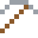

# Stahl

Schon ein bis zwei Prozent Kohlenstoff machen aus weichem Eisen harten Stahl: Die Kohlenstoffatome sperren die Eisenatome beim Verrutschen.

| Eigenschaft | Wert |
|---|---|
|  | Aus Eisen mit etwas Kohlenstoff |
| Dichte | 7,85 g/cm³ |
| Schmilzt bei | 1427 °C |
| Härte | 5,5 (Mohs) |

## Herstellen

- 3 × [Eisenbarren](../elemente/eisenbarren.md) + 1 × [Kohle](../gegenstaende/kohle.md) → 3 × [Stahl](../legierungen/stahl.md) (Induktionsofen, 8 s)

## Ausrüstung

Aus Stahl gibt es Werkzeuge, Waffen und Rüstung (Stufe 3):

-  Stahlspitzhacke: 3 × Stahl + 2 × Bretter
-  Stahlaxt: 3 × Stahl + 2 × Bretter
-  Stahlschwert: 2 × Stahl + 1 × Bretter
-  Stahlhelm: 5 × Stahl
-  Stahlharnisch: 8 × Stahl
-  Stahlbeinschutz: 7 × Stahl
-  Stahlstiefel: 4 × Stahl

## Verwendet für

[Edelstahl](../legierungen/edelstahl.md), [Damaszener Stahl](../legierungen/damaszener_stahl.md), [Schnellarbeitsstahl](../legierungen/schnellarbeitsstahl.md), [Maraging-Stahl](../legierungen/maraging_stahl.md)

