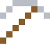
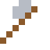

# Stellit

So verschleißfest, dass Sägezähne und Ventile damit beschichtet werden – auch rotglühend bleibt es hart.

| Eigenschaft | Wert |
|---|---|
|  | Aus Cobalt und Chrom (sehr verschleißfest) |
| Dichte | 8,4 g/cm³ |
| Schmilzt bei | 1327 °C |
| Härte | 6,5 (Mohs) |

## Herstellen

- 2 × [Cobalt](../elemente/cobalt.md) + 1 × [Chrom](../elemente/chrom.md) → 3 × [Stellit](../legierungen/stellit.md) (Induktionsofen, 8 s)

## Ausrüstung

Aus Stellit gibt es Werkzeuge, Waffen und Rüstung (Stufe 3):

-  Stellitspitzhacke: 3 × Stellit + 2 × Bretter
-  Stellitaxt: 3 × Stellit + 2 × Bretter
-  Stellitschwert: 2 × Stellit + 1 × Bretter
-  Stellithelm: 5 × Stellit
-  Stellitharnisch: 8 × Stellit
-  Stellitbeinschutz: 7 × Stellit
-  Stellitstiefel: 4 × Stellit

