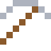
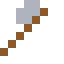

# Titanlegierung

Ti-6Al-4V ist die Hälfte allen Titans der Welt: Flugzeugturbinen, Knochenschrauben.

| Eigenschaft | Wert |
|---|---|
| Aus Ti-6Al-4V | Titan mit Aluminium und Vanadium |
| Dichte | 4,43 g/cm³ |
| Schmilzt bei | 1605 °C |
| Härte | 6,5 (Mohs) |

## Herstellen

- 9 × [Titanbarren](../elemente/titanbarren.md) + 1 × [Aluminium-Vanadium](../legierungen/aluminium_vanadium.md) → 10 × [Titanlegierung](../legierungen/titanlegierung.md) (Induktionsofen, 8 s)

## Ausrüstung

Aus Titanlegierung gibt es Werkzeuge, Waffen und Rüstung (Stufe 3):

-  [Titanlegierungspitzhacke](../legierungen/titanlegierung.md): 3 × Titanlegierung + 2 × Bretter
-  [Titanlegierungaxt](../legierungen/titanlegierung.md): 3 × Titanlegierung + 2 × Bretter
-  [Titanlegierungschwert](../legierungen/titanlegierung.md): 2 × Titanlegierung + 1 × Bretter
-  [Titanlegierunghelm](../gegenstaende/titanlegierunghelm.md): 5 × Titanlegierung
-  [Titanlegierungharnisch](../gegenstaende/titanlegierungharnisch.md): 8 × Titanlegierung
-  [Titanlegierungbeinschutz](../gegenstaende/titanlegierungbeinschutz.md): 7 × Titanlegierung
-  [Titanlegierungstiefel](../gegenstaende/titanlegierungstiefel.md): 4 × Titanlegierung

