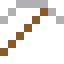
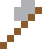
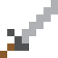

# Zirkaloy

Hüllt das Uran in Brennstäben ein: lässt Neutronen durch und rostet nicht im heißen Wasser.

| Eigenschaft | Wert |
|---|---|
|  | Aus Zirconium mit Zinn (Brennstabhüllen) |
| Dichte | 6,56 g/cm³ |
| Schmilzt bei | 1827 °C |
| Härte | 5 (Mohs) |

## Herstellen

- 9 × [Zirconium](../elemente/zirconium.md) + 1 × [Zinn](../elemente/zinn.md) → 10 × [Zirkaloy](../legierungen/zirkaloy.md) (Induktionsofen, 8 s)

## Ausrüstung

Aus Zirkaloy gibt es Werkzeuge, Waffen und Rüstung (Stufe 2):

-  Zirkaloyspitzhacke: 3 × Zirkaloy + 2 × Bretter
-  Zirkaloyaxt: 3 × Zirkaloy + 2 × Bretter
-  Zirkaloyschwert: 2 × Zirkaloy + 1 × Bretter
-  Zirkaloyhelm: 5 × Zirkaloy
-  Zirkaloyharnisch: 8 × Zirkaloy
-  Zirkaloybeinschutz: 7 × Zirkaloy
-  Zirkaloystiefel: 4 × Zirkaloy

## Verwendet für

[Forschungsreaktor](../gegenstaende/forschungsreaktor.md)

